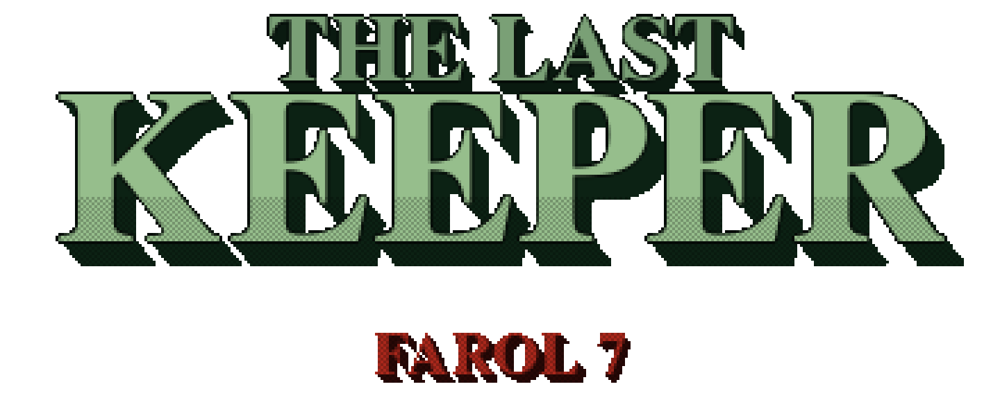
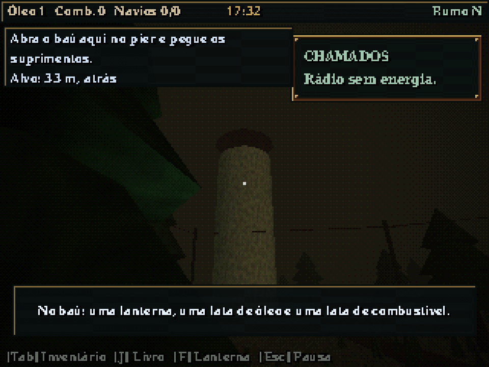
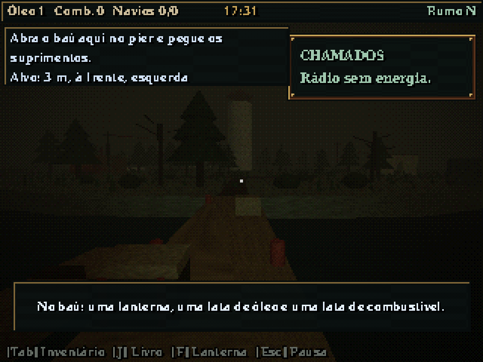
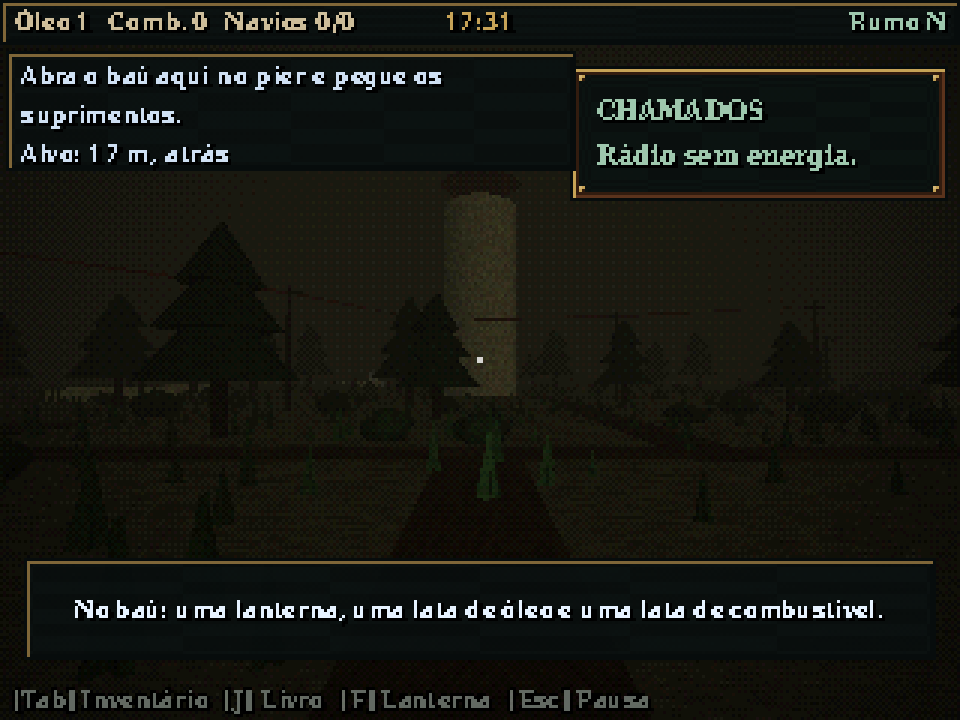
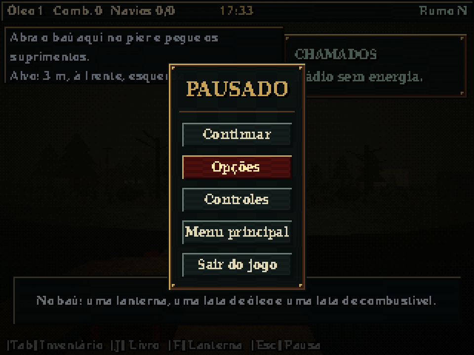
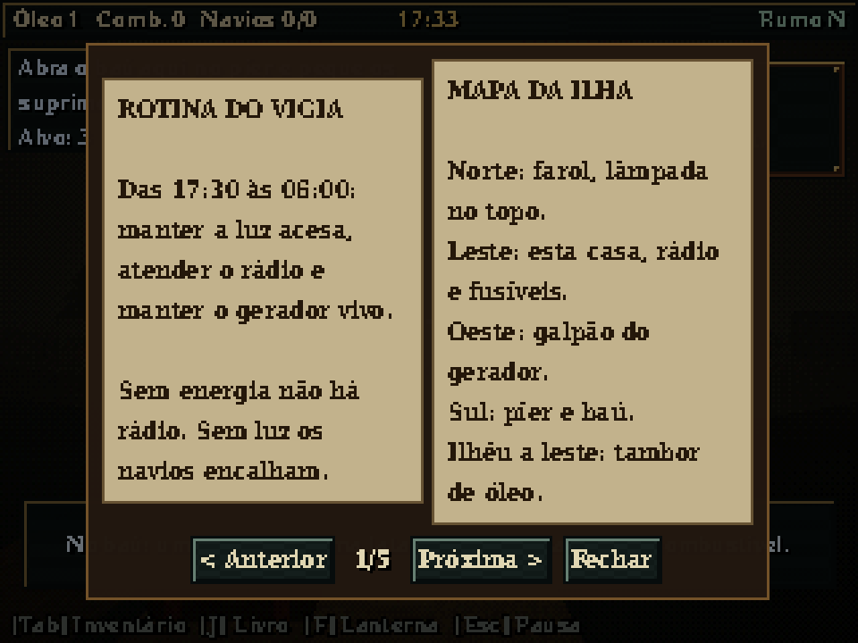
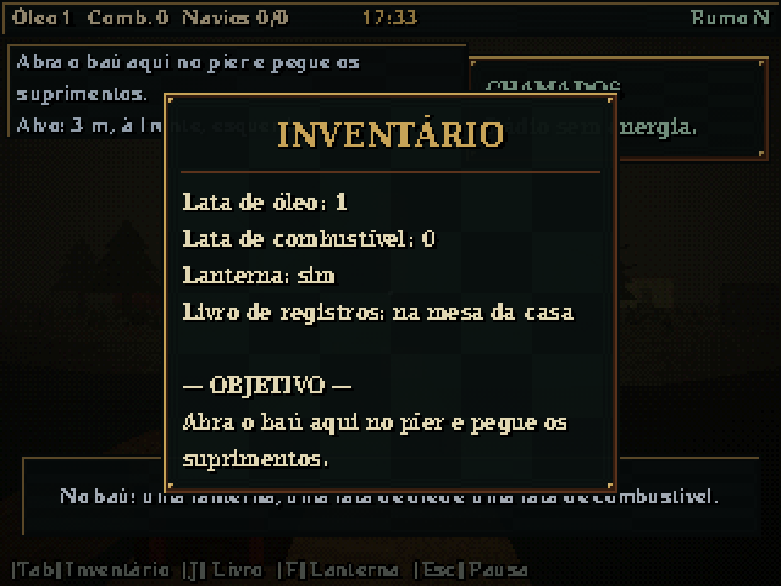
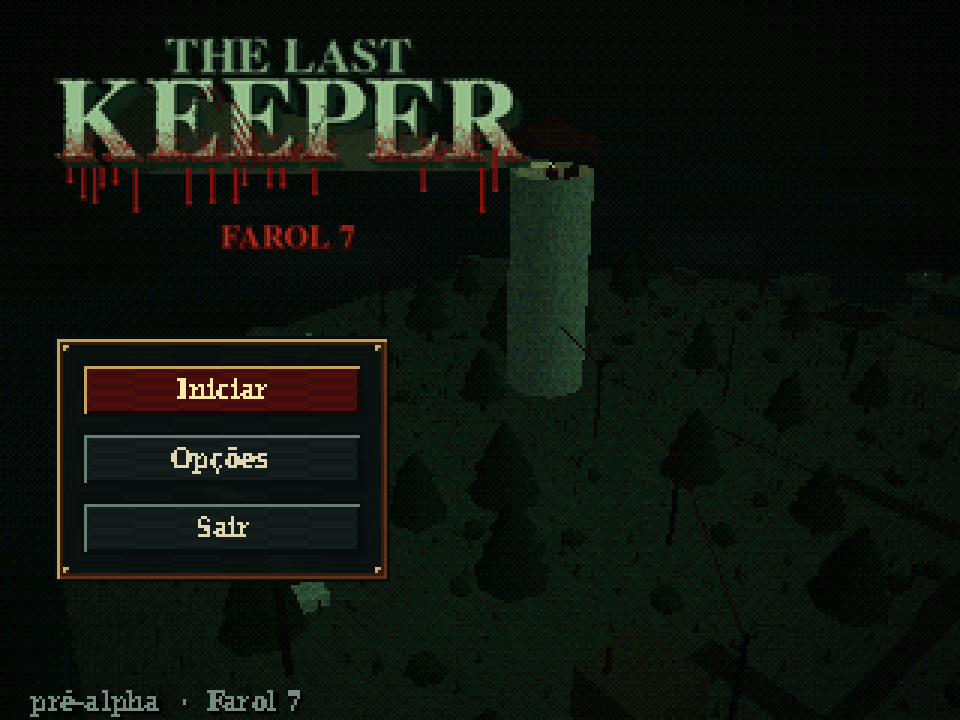

<div align="center">



**English** · [Português (BR)](README.pt-BR.md)

*A first-person survival-management game with atmospheric horror and a PS1 look.*




</div>

---

## The night shift

You are the only keeper of **Lighthouse 7**, on a rocky island at the end of the shipping lane. Every night, from 17:30 to 06:00, you must keep the lamp burning, the generator running and the radio tuned. The ships out there depend on you — but **not every ship calling on the radio should be there**.

Compare what the radio says with what the logbook says, decide who gets the light, and live with what the sea does next.

> **Status:** pre-alpha. The first playable demo (one full night) is planned for **7 January 2027**.

## Screenshots

<table>
<tr>
<td></td>
<td></td>
</tr>
<tr>
<td></td>
<td></td>
</tr>
<tr>
<td></td>
<td></td>
</tr>
</table>

## Features (so far)

- **PS1 rendering:** native 320×240, vertex jitter, affine texture warping, 15-bit color with ordered dithering, depth fog
- **Steam lamp console:** bring pressure and temperature into the green before opening the valve — open it cold and you drown the flame
- **Generator and fuse boxes:** valves in the order of the logbook, three breakers, limited capacity
- **Portable radio:** every third ship lies about its cargo
- **Inventory and status:** 32 slots, thirst, hunger and health
- **Night clock:** 17:30 → 06:00 in 15 real minutes, with difficulty rising as the night goes on
- **Procedural audio:** no sound assets, layered music that rises with tension, lo-fi SPU texture
- **Save slots, opening cutscene, options, PS4 controller and touch HUD**

## Requirements

- [Godot 4.7+](https://godotengine.org/download) (standard or .NET build)
- A GPU with OpenGL 3.3 support (the project uses the Compatibility renderer)

## Running

1. Clone the repository.
2. Open Godot, click **Import** and select `project.godot`.
3. Press **F5**.

Or from the terminal:

```bash
godot --path .
```

## Controls

| Action | Keyboard / mouse | PS4 controller | Touch |
|---|---|---|---|
| Move | W A S D | Left stick | Virtual joystick |
| Look | Mouse | Right stick | Drag on the right side |
| Sprint | Shift | — | Push the joystick to the edge |
| Interact (press or hold) | E | Square | Interact button |
| Flashlight | F | R1 | Button |
| Portable radio | R | D-pad ↑ | Button |
| Logbook | J | L1 | Button |
| Inventory | Tab | Triangle | Button |
| Pause | Esc | Options | Button |

> The full and up-to-date table lives in [GDD §8](docs/GDD.md).

## Tests

Headless tests, no window needed:

```bash
godot --headless --path . --script res://tests/smoke_test.gd
godot --headless --path . --script res://tests/puzzle_test.gd
godot --headless --path . --script res://tests/status_test.gd
```

## Tweaking the PS1 effect

Under **Project → Project Settings → Shader Globals**:

| Global | Effect |
|---|---|
| `psx_vertex_snap` | Vertex jitter grid size in pixels (`0` turns it off) |
| `psx_affine_strength` | Texture warping, from `0` (correct) to `1` (full PS1) |

Color depth and dithering are set on the `PsxPost/Filter` node in `main.tscn`.

## Project structure

```
audio/         Procedural synth, audio director
docs/          GDD, story and development plan (in Portuguese)
interaction/   Interactable component
items/         Inventory and pickups
materials/     Greybox materials
player/        First-person player
puzzles/       Generator, fuse box, radio, cellar lock, tide
shaders/       PS1 shaders (lit, water, post-processing)
tests/         Headless tests
ui/            HUD, consoles, menus, touch controls
world/         Island, lighthouse, spiral ramp, beacon
main.tscn      Main scene
```

## Documentation

- [Game Design Document](docs/GDD.md)
- [Story](docs/HISTORIA.md)
- [Development plan](docs/PLANO.md)
- [Sprints to launch](docs/SPRINTS.md)

## License

Source code: [MIT](LICENSE). Art, narrative and other creative assets: [CC BY-NC 4.0](LICENSE-ASSETS.md). Names and logos are not covered by either license.
