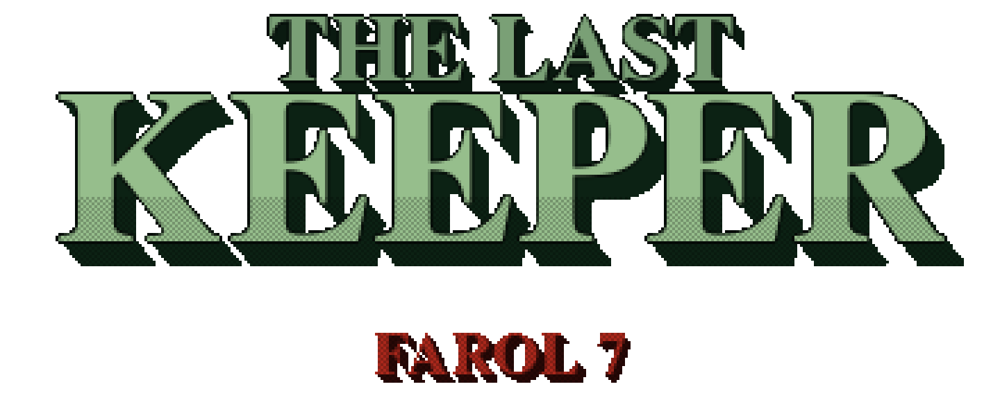
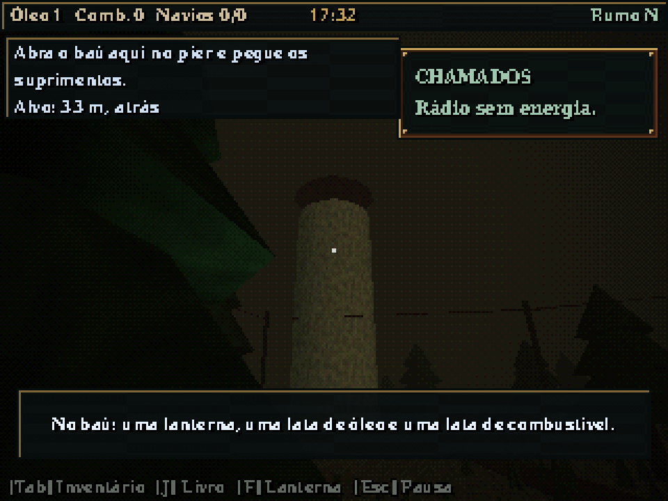
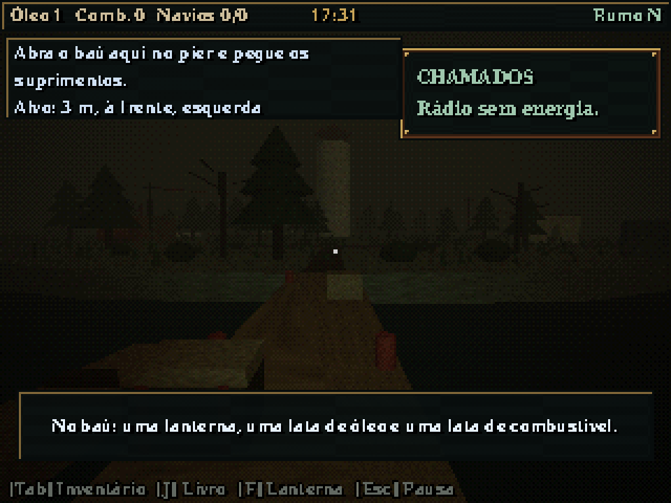
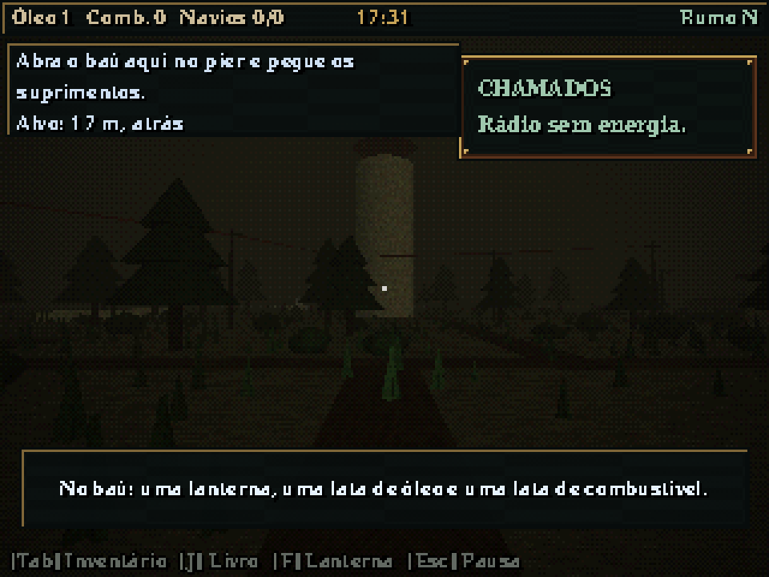
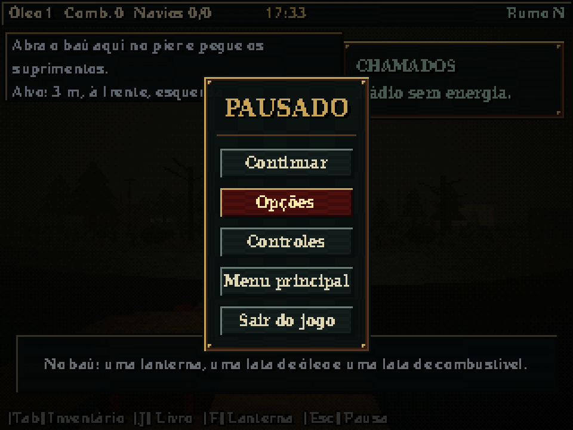
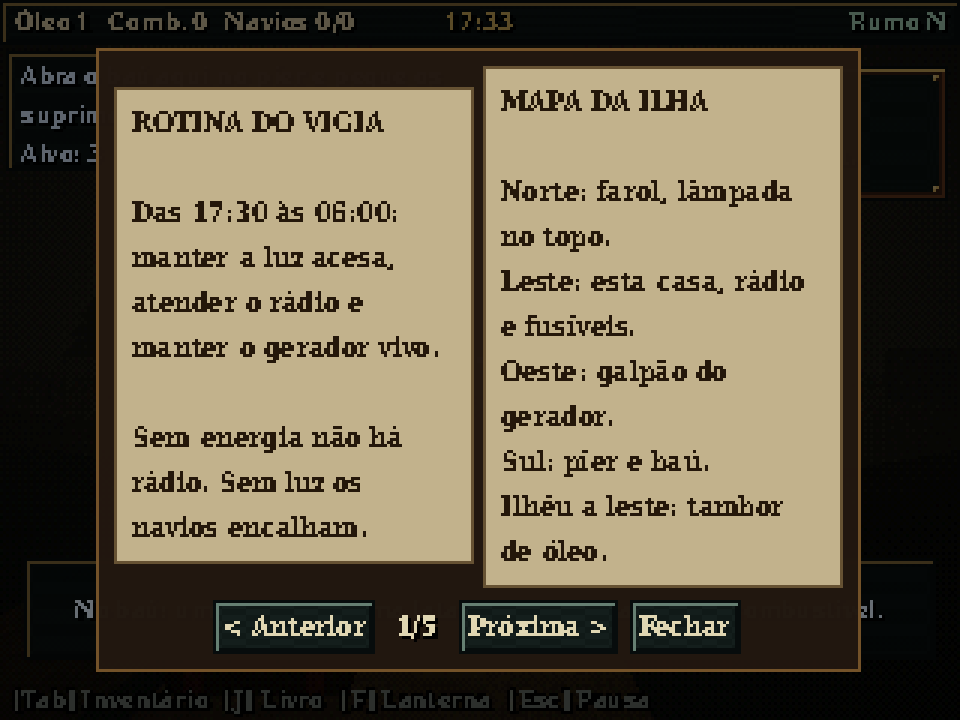
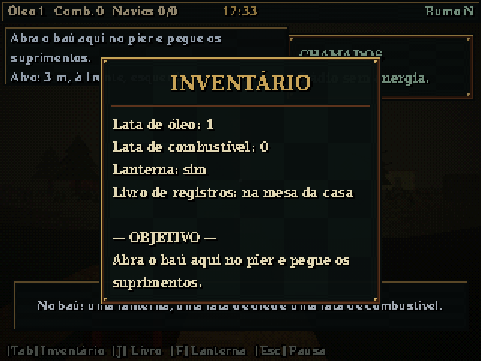
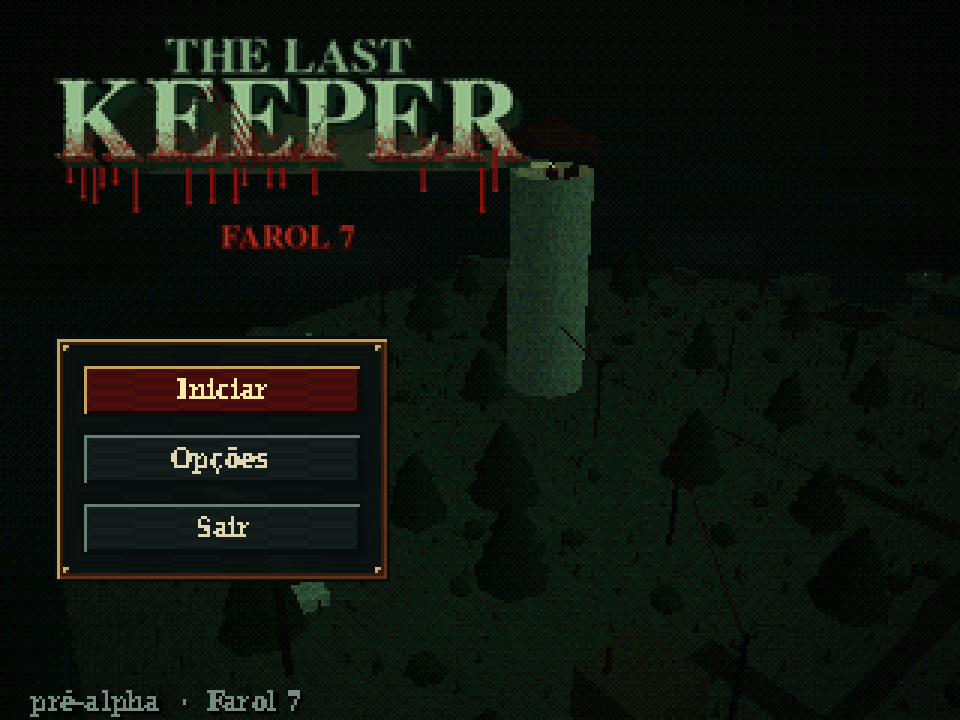

<div align="center">



[English](README.md) · **Português (BR)**

*Jogo de sobrevivência e gestão em primeira pessoa, com terror atmosférico e visual de PS1.*




</div>

---

## O turno da noite

Você é o único vigia do **Farol 7**, numa ilha rochosa no fim da rota de navegação. Toda noite, das 17:30 às 06:00, você precisa manter a lâmpada acesa, o gerador funcionando e o rádio atento. Os navios dependem de você. Mas **nem todo navio que chama pelo rádio deveria estar ali**.

Compare o que o rádio diz com o que o livro de registros diz, decida quem recebe a luz e conviva com o que o mar fizer depois.

> **Status:** pré-alfa. A primeira demo jogável (uma noite completa) está prevista para **7 de janeiro de 2027**.

## Capturas de tela

<table>
<tr>
<td></td>
<td></td>
</tr>
<tr>
<td></td>
<td></td>
</tr>
<tr>
<td></td>
<td></td>
</tr>
</table>

## O que já tem

- **Render PS1:** 320×240 nativo, vértices tremendo, texturas distorcidas (mapeamento afim), cor de 15 bits com dithering e neblina de profundidade
- **Console da lâmpada a vapor:** leve pressão e temperatura ao verde antes de abrir a válvula; abrir frio afoga a chama
- **Gerador e disjuntores:** válvulas na ordem do livro de registros, três disjuntores, capacidade limitada
- **Rádio portátil:** um navio a cada três mente sobre a carga
- **Inventário e status:** 32 slots, sede, fome e vida
- **Relógio da noite:** 17:30 → 06:00 em 15 minutos reais, com dificuldade crescente
- **Áudio procedural:** sem assets de som, música em camadas que sobe com a tensão, textura lo-fi do SPU
- **Slots de save, cutscene de abertura, opções, controle de PS4 e HUD de toque**

## Requisitos

- [Godot 4.7+](https://godotengine.org/download) (versão padrão ou .NET)
- Placa de vídeo com suporte a OpenGL 3.3 (o projeto usa o renderizador Compatibility)

## Como rodar

1. Clone o repositório.
2. Abra o Godot, clique em **Importar** e selecione o `project.godot`.
3. Aperte **F5**.

Ou pelo terminal:

```bash
godot --path .
```

## Controles

| Ação | Teclado / mouse | Controle PS4 | Toque |
|---|---|---|---|
| Andar | W A S D | Analógico esquerdo | Joystick virtual |
| Olhar | Mouse | Analógico direito | Arrastar no lado direito |
| Correr | Shift | — | Empurrar o joystick até a borda |
| Interagir (apertar ou segurar) | E | Quadrado | Botão de interagir |
| Lanterna | F | R1 | Botão |
| Rádio portátil | R | Direcional ↑ | Botão |
| Livro | J | L1 | Botão |
| Inventário | Tab | Triângulo | Botão |
| Pausa | Esc | Options | Botão |

> A tabela completa e atualizada fica na [GDD §8](docs/GDD.md).

## Testes

Testes automáticos sem janela:

```bash
godot --headless --path . --script res://tests/smoke_test.gd
godot --headless --path . --script res://tests/puzzle_test.gd
godot --headless --path . --script res://tests/status_test.gd
```

## Ajustando o efeito PS1

Em **Projeto → Configurações do Projeto → Shader Globals**:

| Global | Efeito |
|---|---|
| `psx_vertex_snap` | Tamanho da grade do tremor dos vértices, em pixels (`0` desliga) |
| `psx_affine_strength` | Distorção das texturas, de `0` (correta) a `1` (PS1 total) |

A profundidade de cor e o dithering ficam no nó `PsxPost/Filter` da `main.tscn`.

## Estrutura do projeto

```
audio/         Sintetizador procedural, diretor de áudio
docs/          GDD, história e plano de desenvolvimento
interaction/   Componente Interactable
items/         Inventário e itens no chão
materials/     Materiais do greybox
player/        Jogador em primeira pessoa
puzzles/       Gerador, disjuntores, rádio, cadeado, maré
shaders/       Shaders PS1 (iluminado, água, pós-processamento)
tests/         Testes automáticos (headless)
ui/            HUD, consoles, menus, controles de toque
world/         Ilha, farol, rampa em espiral, lâmpada
main.tscn      Cena principal
```

## Documentação

- [Game Design Document](docs/GDD.md)
- [História](docs/HISTORIA.md)
- [Plano de desenvolvimento](docs/PLANO.md)
- [Sprints até o lançamento](docs/SPRINTS.md)

## Licença

Código: [MIT](LICENSE). Arte, narrativa e demais assets criativos: [CC BY-NC 4.0](LICENSE-ASSETS.md). Nomes e logos não estão cobertos por nenhuma das duas.
